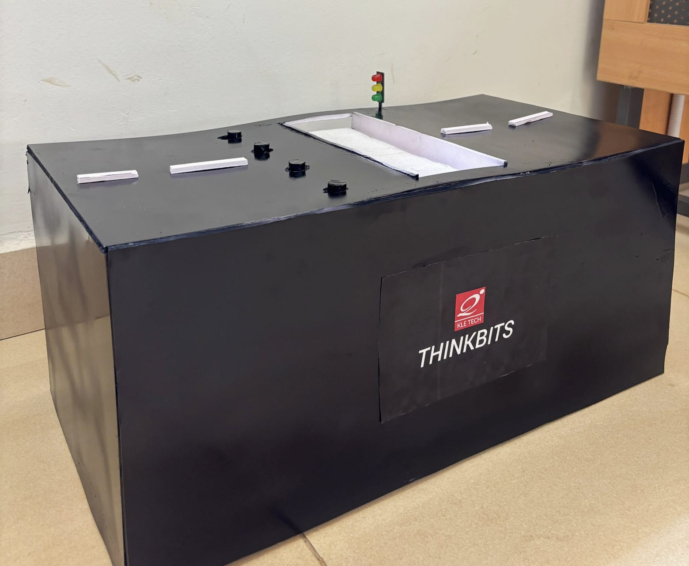

# SMART ZEBRA CROSSING FOR PEDESTRIAN SAFETY

### Sustainable Infrastructure Technologies

---

## 1. PROJECT OVERVIEW

The **Smart Zebra Crossing for Pedestrian Safety** is an Arduino-based hardware prototype developed to improve pedestrian safety through automated traffic signals, motor-operated road-blocking poles, and a motorized crossing platform.

The system coordinates traffic signals and motor operations through a predefined control sequence to provide a more organized and controlled pedestrian crossing experience.

## 2. PROBLEM STATEMENT

Traditional zebra crossings primarily depend on drivers identifying pedestrians and voluntarily stopping their vehicles. This can create safety risks, particularly for children, elderly people, and individuals with disabilities.

The proposed project aims to address this challenge by developing an automated pedestrian crossing system that coordinates traffic signals and mechanical operations to improve crossing safety and traffic management.

## 3. PROPOSED SOLUTION

The proposed system uses an Arduino microcontroller to control and coordinate the following operations:

- Automated traffic signal indicators.
- Motor-operated road-blocking poles.
- Motor-controlled pedestrian crossing platform.
- Timed operational sequences.
- Coordinated traffic and pedestrian movement.

## 4. HARDWARE COMPONENTS

The following hardware components are used in the prototype:

1. Arduino microcontroller board.
2. Red LED.
3. Yellow LED.
4. Green LED.
5. DC motors for road-blocking pole operation.
6. DC motor for crossing platform operation.
7. Motor driver circuitry.
8. Connecting wires.
9. Supporting electronic and mechanical components.

## 5. WORKING PRINCIPLE

The system operates according to a predefined sequence programmed into the Arduino microcontroller.

| Stage | Operation | Duration |
|---|---|---|
| Green Signal | Both motor channels remain OFF. | 5 seconds |
| First Yellow Signal | Pole motor operates in one direction. | 3 seconds |
| Red Signal | Crossing platform motor operates. | 10 seconds |
| Second Yellow Signal | Pole motor operates in the opposite direction. | 3 seconds |

After completing all four stages, the system repeats the sequence continuously.

The Arduino controls the LEDs and motor driver signals according to the programmed timing sequence.

## 6. PIN CONFIGURATION

The following table shows the Arduino pin connections used in the prototype.

| Component | Arduino Pin |
|---|---|
| Red LED | 10 |
| Yellow LED | 9 |
| Green LED | 8 |
| Pole Motor IN1 | 6 |
| Pole Motor IN2 | 7 |
| Crossing Platform Motor IN3 | 2 |
| Crossing Platform Motor IN4 | 3 |

## 7. TECHNOLOGIES USED

- Arduino Programming
- Embedded Systems
- Electrical and Electronic Circuits
- DC Motor Control
- Microcontroller-Based Automation
- Hardware Prototyping

## 8. APPLICATIONS

The proposed system can be considered for implementation in the following locations:

- Smart city infrastructure.
- School and college zones.
- Railway stations and bus terminals.
- High-traffic road intersections.
- Commercial and public areas.
- Pedestrian crossing areas used by elderly and differently-abled individuals.

## 9. FUTURE SCOPE

The prototype can be enhanced through the integration of additional technologies and safety features.

Potential improvements include:

1. Integration of pedestrian detection sensors.
2. Addition of a pedestrian request button.
3. Implementation of intelligent traffic management.
4. Integration of obstacle detection mechanisms.
5. Development of emergency stop functionality.
6. Improved coordination between vehicle traffic and pedestrian movement.
7. Development of a full-scale automated pedestrian crossing system.

## 10. PROJECT PROTOTYPE

The following image represents the hardware prototype developed for the project.

## 11. PROJECT DETAILS

**Institution:** KLE Technological University

**Department:** Electrical and Electronics Engineering

**Project Theme:** Sustainable Infrastructure Technologies

**Project Type:** Arduino-Based Hardware Prototype

## 12. PROJECT OBJECTIVE

The primary objective of this project is to develop an automated pedestrian crossing prototype using embedded system technology. The system demonstrates how microcontrollers, traffic signal indicators, and motor control mechanisms can be integrated to explore improved pedestrian safety and contribute to the development of sustainable urban infrastructure.

---

## CONCLUSION

The Smart Zebra Crossing for Pedestrian Safety demonstrates the application of Arduino-based automation in pedestrian crossing management. By integrating traffic signal control and motor-operated mechanisms, the prototype provides a practical demonstration of an automated crossing concept.

The project also provides opportunities for further development through intelligent sensors, pedestrian detection, and advanced traffic management technologies.
